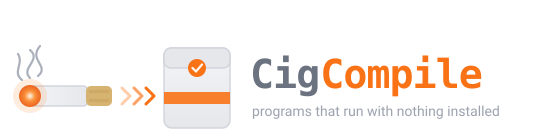
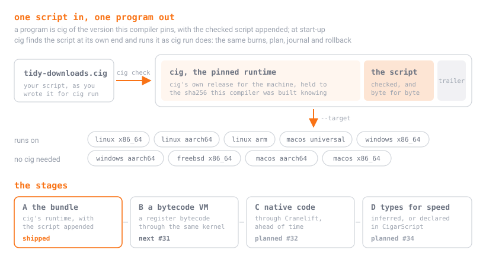
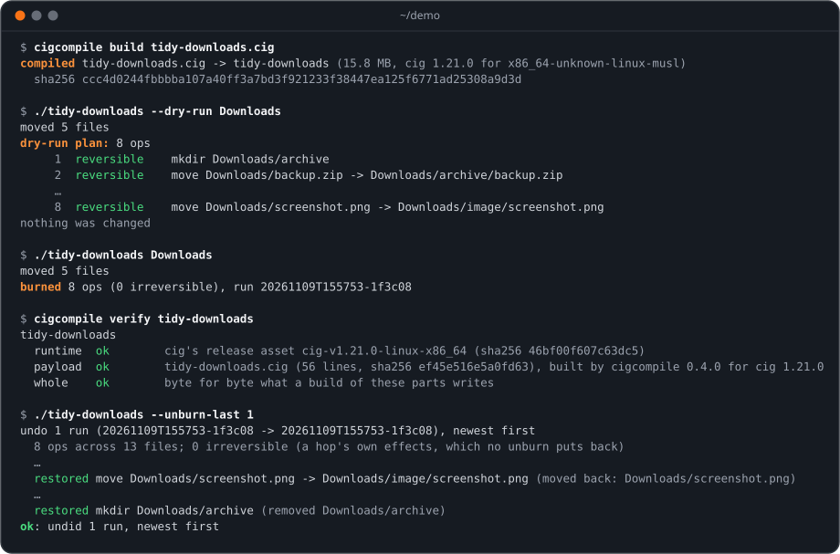

<p align="center">
  
</p>

<p align="center">
  <b>Your CigScript scripts, as programs that run with nothing installed.</b><br>
  <i>A tool from the maker of <a href="https://github.com/otmof-ops/cig-script">CigScript</a>: the same burns, plan and rollback as <code>cig run</code>, byte for byte.</i>
</p>

<p align="center">
  <a href="https://github.com/otmof-ops/cig-script"></a>
  <a href="https://github.com/otmof-ops/cig-compile/releases/latest"></a>
  <a href="docs/commands.md#cigcompile-targets"></a>
  <a href="docs/roadmap.md"></a>
  <a href="LICENSE"></a>
  
</p>

A script is easy to write and awkward to hand over. Whoever runs it needs
the interpreter, the right version of it, and a reason to trust both: a
Python script needs Python, and a CigScript script needs `cig`. On a
server you don't own, a friend's laptop or a fresh CI runner, that is the
part that goes wrong.

**`cigcompile` makes the script a program.** One file, for any machine cig
is released for, that runs with nothing installed. The program is cig
itself, of the version this compiler pins, with your checked script sealed
onto its end, so it does exactly what `cig run` does: the same burns, the
same plan from `--dry-run`, the same journal, and the same undo. The
differential suite holds every script CigScript carries to that, byte for
byte, on every pull request.

<p align="center"></p>

## Thirty seconds

```sh
cigcompile build tidy-downloads.cig          # one file: ./tidy-downloads
./tidy-downloads --dry-run ~/Downloads       # the plan; nothing changes
./tidy-downloads ~/Downloads                 # for real, every move journaled
./tidy-downloads --unburn-last 1             # changed your mind: everything back
cigcompile build tidy-downloads.cig --target universal2-apple-darwin   # one program for every Mac
cigcompile verify tidy-downloads             # each part is what a build writes
```

[Getting started](docs/getting-started.md) walks through it in ten
minutes, install included.

## See it run

[`tidy-downloads.cig`](https://github.com/otmof-ops/cig-script/blob/main/examples/tidy-downloads.cig)
is one of CigScript's own examples: it sorts a folder's loose files into
folders by kind. Built into a program, it plans, runs, proves what it is,
and puts everything back, with no cig on the machine:

<p align="center"></p>

## What you get

| what you get | how |
|---|---|
| one file, nothing installed | a program is cig with your script appended: it needs no cig, no runtime and no network |
| every machine cig is released for | `--target` builds for Linux (x86_64, aarch64, arm), macOS (each, or one universal program), Windows (x86_64, aarch64) and FreeBSD, from any machine |
| what `cig run` does, exactly | burns, `--dry-run` plans, journals, rollback, the four kinds of no and every explain page are cig's own; the differential suite proves it |
| an undo inside the program | `--unburn-last N`, `--unburn-since AGE` and `--unburn-to <run>` put back a stretch of the program's own runs, and leave other programs' alone |
| programs you can check | `cigcompile verify` holds the runtime to the sha256 this compiler pins, the script to its record and the whole file to a rebuild; `--sign` adds an SSH signature, `--pass` a pass naming the machine that built it, `--sbom` a CycloneDX SBOM, and `audit` reads the hardening from the headers |
| the same bytes everywhere | the same script, compiler and runtime make the same file on any machine; CI builds one script on five runners and compares them |
| ready to ship | `--emit oci` makes a scratch image of one file, `--emit deb` a Debian package, and `package --brew` or `--scoop` a Homebrew formula or a Scoop manifest |
| all or nothing | a build that signs, writes an SBOM or a package stages every output beside `--out` and moves them into place together, or leaves what was there |
| quick rebuilds | a rebuild that changes nothing touches nothing, in about a millisecond; `--watch` builds again on every save |
| a look inside | `--emit cir` prints the verified IR, `--remarks` says what each pass did, and `--timings` where the build's time went |
| the numbers | `cigcompile bench` runs 29 programs interpreted and compiled, beside Python, Node and Rust ([BENCHMARKS.md](docs/BENCHMARKS.md)) |

## Measuring

`cigcompile bench` times the 29 programs of the set, interpreted and compiled, from fresh folders: output first (a wrong one gets no time), then the median, p10, p90 and CV of each side, and `--ref` beside Python, Node and Rust, each named with its version or said to be not installed.

```sh
cigcompile bench --ref --markdown              # the table, references and all
cigcompile bench --json > main.json            # keep a result (it carries every sample)
cigcompile bench --alloc ./cig-runtime-alloc   # allocation counts, from a runtime built with --features alloc-count
cigcompile bench --against main.json           # the regression gate: exit 1 on a real slowdown
cigcompile bench --trend history               # the nightly trend gate over a folder of dated results
```

A pull request fails on a non-noisy benchmark more than 5% slower than `main`'s, the set's geometric mean more than 2% slower, or peak memory or allocations more than 10% over; each by a Mann-Whitney test, so noise does not fail it. The nightly keeps the trend and fails after five slower nights. [BENCHMARKS.md](docs/BENCHMARKS.md#the-gates) has the rules and the tests.

## Guides

| guide | read it when you want to |
|---|---|
| [Getting started](docs/getting-started.md) | install cigcompile, build your first program, and run it where there is no cig |
| [Shipping a program](docs/shipping.md) | sign it, check it, give it an SBOM, or make an image, a `.deb`, a formula or a manifest of it |
| [Commands](docs/commands.md) | look up any command, flag, exit code, environment variable or file cigcompile keeps |
| [Troubleshooting](docs/troubleshooting.md) | understand an `E10xx`, or a build that won't go |
| [How it works](docs/how-it-works.md) | read the compiler's insides before you change them |
| [Roadmap](docs/roadmap.md) | see the stages to come, and how a request gets there |
| [Benchmarks](docs/BENCHMARKS.md) | read the numbers, and run them yourself |
| [The backend decision](docs/decisions/0001-backend.md) | see why stage A is a bundle, and what B, C and D will be |

## Get help, ask for things, pitch in

| you want to | go here |
|---|---|
| get unstuck building or shipping a program | [a guidance request](https://github.com/otmof-ops/cig-compile/issues/new?template=guidance-request.yml) |
| build for a machine or an output it doesn't make yet | [a target request](https://github.com/otmof-ops/cig-compile/issues/new?template=target-request.yml) |
| get something your other compiler does better | [a quality-of-life request](https://github.com/otmof-ops/cig-compile/issues/new?template=qol-request.yml) |
| report something that went wrong | [a bug report](https://github.com/otmof-ops/cig-compile/issues/new?template=bug-report.yml) |
| report a problem in the language itself | [CigScript's issues](https://github.com/otmof-ops/cig-script/issues) |
| report a security problem | [SECURITY.md](SECURITY.md), never a public issue |
| send a fix | [CONTRIBUTING.md](CONTRIBUTING.md) |

[SUPPORT.md](SUPPORT.md) says what happens after you ask.

## Install

cigcompile is installed by [ciginstaller](https://github.com/otmof-ops/cig-installer),
which checks every download against the release's published sha256 and
attestation before it puts anything on your machine:

```sh
ciginstaller install pack builder     # cigcompile with the rest of the builder's tools
ciginstaller install carton           # or the whole carton, the family at one tested version
cigcompile --version
```

No ciginstaller yet? [How to get it](https://github.com/otmof-ops/cig-installer#install)
is at the top of its README; once it has a release, that page shows its
bootstrap script. Keeping cigcompile current and removing it are the
installer's too: `ciginstaller update`, and `ciginstaller uninstall
cigcompile`. `ciginstaller doctor --tools` checks this machine, and
includes what cigcompile can see of its own state.

To build cigcompile from a checkout instead, see
[CONTRIBUTING.md](CONTRIBUTING.md).

The compiler needs nothing else: the first build for a machine fetches
cig's release for it, once, and holds it to the sha256 this compiler was
built knowing. `cigcompile fetch --all` does that ahead of time, for a
machine that builds offline. Releases keep their assets (`cigcompile-<version>-<machine>`,
each with a `.sha256`), the `LICENSE`, `NOTICE`, `THIRD-PARTY-NOTICES.md`
and the SBOM beside them; they are what the installer reads.

## Where it runs

Programs run on the nine machines `cigcompile targets` lists: Linux on
x86_64, aarch64 and 32-bit ARM, macOS on each architecture or as one
universal program, Windows on x86_64 and aarch64, and FreeBSD on x86_64.
A Linux program runs on any Linux, because its runtime is static. CI runs
each program on a runner of its own machine, the universal one on both
Macs; 32-bit ARM Linux and FreeBSD programs are built and checked there,
not run. The compiler itself is released for the same machines.

## Limits, honestly

- **A program carries cig whole.** A compiled hello is about 13 MB and
  starts in about 8 ms here, as cig does. A runtime that is only what a
  program uses waits on the crate split ([#1](https://github.com/otmof-ops/cig-compile/issues/1),
  [#4](https://github.com/otmof-ops/cig-compile/issues/4)).
- **A program runs at the interpreter's speed.** Stage A is the bundle; the
  speed comes with the bytecode VM and native code
  ([#31](https://github.com/otmof-ops/cig-compile/issues/31),
  [#32](https://github.com/otmof-ops/cig-compile/issues/32)).
- **The box is Linux's.** A program's boxed hop is refused or falls back
  elsewhere, as `cig`'s is (`E777`, `E763`).
- **Signing is SSH's.** Apple Developer ID and Windows Authenticode need
  identities you hold, and are a separate step.

Each of these is on the [roadmap](docs/roadmap.md).

## Part of CigScript

CigCompile compiles CigScript, the language at
[otmof-ops/cig-script](https://github.com/otmof-ops/cig-script), and it is
built on it: it reads, checks and lowers a script through the `cigscript`
library of the version it pins, and the programs it makes are cig of that
version with the script inside. The lexicon, the rules the kernel keeps and
the payload format a program carries ([PROGRAMS.md](https://github.com/otmof-ops/cig-script/blob/main/docs/PROGRAMS.md))
are there. Later, CigarScript will compile here too.

## Licensing

- **Code** (`src/`, `tests/`, `bench/`, `ci/`, `fuzz/`): **source-available, not open source.** Under the
  [Functional Source License, version 1.1, with an Apache-2.0 future license
  (FSL-1.1-ALv2)](LICENSE). The Open Source Initiative does not count it as an
  open source license, and this project does not call it one.
  - *What you may do.* Use it, including inside a company for its own work;
    read it, study it, change it and share it with the license attached; and
    help others use it. The source is here for all of that.
  - *What you may not do.* Make it available to others in a commercial product
    or service that substitutes for it or does the same job. Selling it, or
    selling access to it, is the clear case.
  - *It becomes Apache-2.0.* Each version converts to
    [Apache-2.0](LICENSES/Apache-2.0.txt) two years after it is made
    available.
  - *Earlier releases.* Every release through v0.3.0 was made under Apache-2.0 and stays under it. [LICENSING.md](LICENSING.md)
    lists which versions carry which license.
- **Documentation** (`docs/`, this README and the other guides at the root):
  [CC BY 4.0](LICENSES/CC-BY-4.0.txt). Reuse and adapt with credit.
- **The programs it makes.** A program is cig with your script appended. Your
  script stays yours, under whatever license you give it, and nothing in this
  repository's license reaches it. The cig inside the program is CigScript's:
  Apache-2.0 for cig releases through v1.20.0, FSL-1.1-ALv2 after that. Whoever
  passes a program on gives the recipient the LICENSE and
  [NOTICE](https://github.com/otmof-ops/cig-script/blob/main/NOTICE) of the cig
  version it embeds, as that license asks of any copy. Whether a given program
  is a Competing Use of cig is decided by the License's own text; this README
  does not change it. [docs/shipping.md](docs/shipping.md) has the details.
- **The name.** CigCompile and cigcompile are trademarks of Jay Taylor, as
  CigScript is. A fork needs a name of its own;
  [TRADEMARKS.md](TRADEMARKS.md) says what is free to do and what to ask about
  first.

Crates compiled into cigcompile are listed in
[THIRD-PARTY-NOTICES.md](THIRD-PARTY-NOTICES.md), each under its own
permissive license. [REUSE.toml](REUSE.toml) maps every path to its license.
Contributions come in under the contributor agreement; see
[CONTRIBUTING.md](CONTRIBUTING.md). Security reports:
[SECURITY.md](SECURITY.md).

